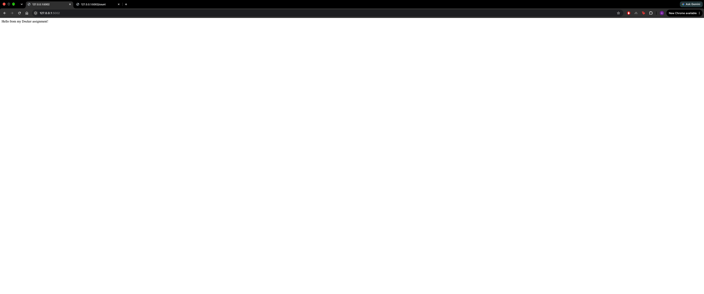
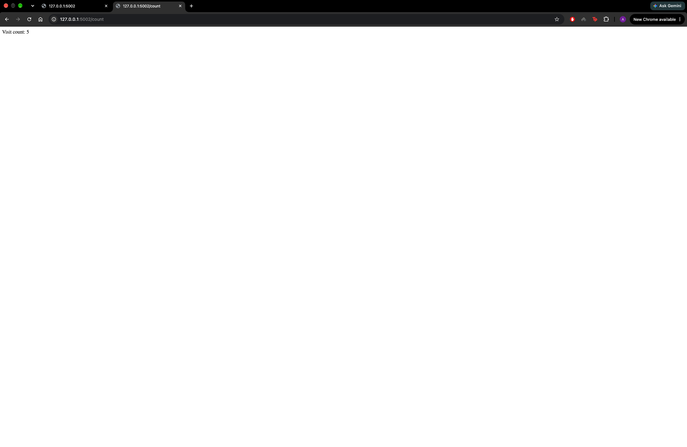
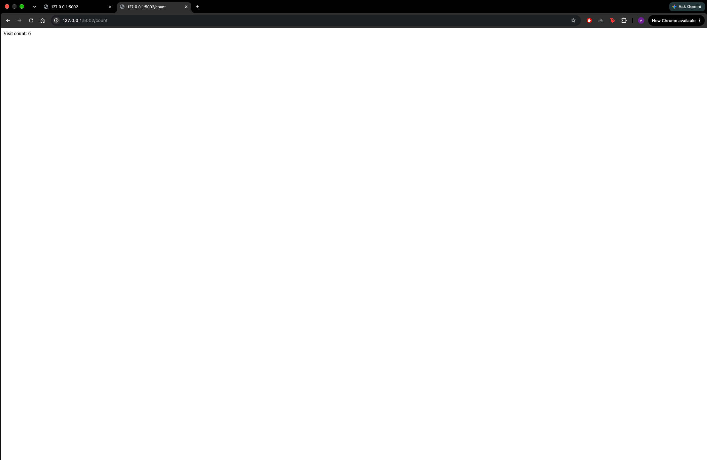

# Docker Assignment 1 — Flask and Redis

## What I built

I built a Flask app with two routes. The homepage (`/`) displays a welcome message. The visit counter (`/count`) adds 1 to the count stored in Redis and displays the new total each time the page is loaded.

## How to run it

With Docker running, open a terminal in the project folder and run:

```bash
docker compose up -d --build
```

- [Welcome page](http://127.0.0.1:5002/)
- [Visit counter](http://127.0.0.1:5002/count)

Refresh the visit counter page to see the total increase by 1. To stop the app, run:

```bash
docker compose down
```

## How the containers connect

Docker Compose puts the Flask and Redis containers on the same network. Flask connects to Redis at `redis:6379`. The name `redis` comes from the service name in `docker-compose.yml`, and `6379` is the port Redis listens on inside its container.

## What I learnt

My browser uses `127.0.0.1:5002` because it connects through a port published on my Mac. Docker forwards that traffic to port `5000` inside the Flask container. Flask uses `redis:6379` because it connects directly to the Redis service over the shared Docker network.

## Troubleshooting

When I started the Compose stack, Docker reported `port is already allocated` for `127.0.0.1:5002`. The Flask container could only start once that host port was free.

To check which running container is using the port, run:

```bash
docker ps --filter publish=5002
```

If the earlier standalone container `assignment-web` appears, stop it and start the Compose stack again:

```bash
docker stop assignment-web
docker compose up -d
```

## Screenshots

### Welcome page



### Visit counter

Before refreshing:



After one refresh:

