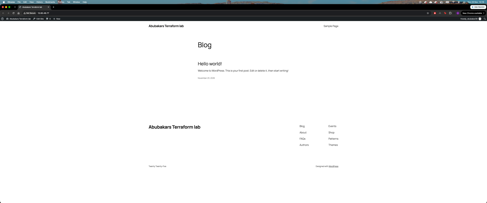

# Assignment 1 - Deploy WordPress Using Terraform

## Aim

Deploy a working WordPress website on AWS using Terraform,
with an installation script that configures the server at first boot.

## What I built

- A VPC and public subnet with an internet gateway and route table.
- A security group allowing incoming HTTP traffic and outgoing connections.
- An Ubuntu EC2 instance running Apache, PHP, MariaDB, and WordPress.
- Terraform outputs showing the instance ID, public IP, and website URL.

## Working website



## File structure
```text
assignment-1-wordpress/
├── main.tf
├── variables.tf
├── outputs.tf
├── user-data.sh
├── .gitignore
├── .terraform.lock.hcl
├── README.md
└── screenshots/
    └── wordpress-homepage.png
```
## What each file does

- main.tf defines the AWS provider, networking, security group, and EC2 instance.
- variables.tf declares inputs for the AWS region, Ubuntu AMI ID, and instance type.
- outputs.tf displays the instance ID, public IP, and WordPress URL.
- user-data.sh installs and configures WordPress and its dependencies at first boot.
- .gitignore excludes local Terraform files and sensitive files from Git.
- .terraform.lock.hcl records the selected provider version and checksums.
- screenshots/ contains evidence of the working website.

## How to deploy

Configure AWS credentials, then open a terminal in
terraform/assignment-1-wordpress and run:

```bash
terraform init
terraform fmt
terraform validate
terraform plan
terraform apply
```

When prompted, enter:

- aws_region: eu-north-1
- ami_id: an official Ubuntu Server 24.04 LTS x86 AMI ID for eu-north-1
- instance_type: t3.micro

Review the plan before confirming the deployment with yes.

## How to verify

Allow a few minutes for the installation script to finish, then run:

```bash
terraform output -raw wordpress_url
```

Open the URL in a browser, complete the WordPress setup,
and confirm the homepage loads.

## What I learned

- How Terraform uses the AWS provider to create cloud resources.
- How variables supply inputs and outputs display deployment details.
- How a VPC, subnet, internet gateway, and route table work together.
- How security groups control incoming and outgoing connections.
- How EC2 user data installs WordPress and its dependencies at first boot.

## Issues and fixes

### Duplicate security group

Terraform initially failed because I declared two security group
resources with the same local name. I removed the duplicate and
kept one resource containing both ingress and egress rules.

### Screenshot preview

My first screenshot file would not display in VS Code.
Dragging the original screenshot file into the screenshots folder
resolved the issue.